# Organization logos

Marks Vicente Matus Icaza reuses on slides, in CVs and proposals, and on [inventorloco.com](https://inventorloco.com). One folder per organization. Files are named `<slug>_<variant>.<ext>`.

These are trademarks of their owners, kept here so a document can identify the organization. Nothing in this folder is a license to redraw, recolor, or treat the mark as a personal or product brand. Prefer the SVG. Where the official master is an EPS, use that for print.

The website’s copies under `assets/logos/`, `assets/csndsp/`, and the hotlinked Edinburgh image were not moved or replaced. Several rasters there were downscaled to about 320 px for the carousel; those copies are flagged below when no better file was available.

42 organizations. Personal files (`mark.svg`, portrait, course figures, flags) are not included.

## Organizations

| | Organization | Slug | Formats | Variants | Source | Where it is used |
|---|---|---|---|---|---|---|
|  | Aalto University | `aalto` | SVG | color | website repo | Publications collaborator carousel. |
| 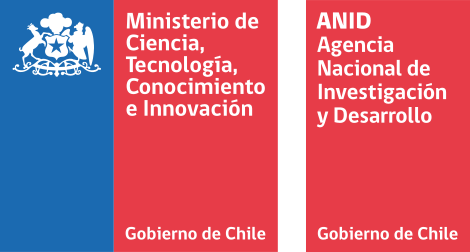 | Agencia Nacional de Investigación y Desarrollo | `anid` | SVG, PNG | color, pluma, pluma_white, stacked | [official](https://anid.cl/media-kit/) | Not embedded in the website. Relevant to Chilean proposals and acknowledgements. |
|  | Alex Ekwueme Federal University, Ndufu-Alike | `funai` | PNG | color | website repo | Publications collaborator carousel. |
|  | Chinese Academy of Sciences | `cas` | PNG | color | website repo | Publications collaborator carousel. |
| 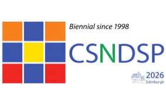 | CSNDSP | `csndsp` | PNG | color | [official](https://eng.ed.ac.uk/csndsp-2026) | index.html and csndsp.html. |
|  | Czech Technical University in Prague | `ctu` | SVG | color, color_en, mono, symbol, symbol_white, vertical, vertical_en, white, white_en | [official](https://www.cvut.cz/logo-a-graficky-manual) | cv.html timeline (2019 research stay) and collaborator carousel; publications map. |
| 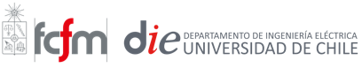 | Departamento de Ingeniería Eléctrica, Universidad de Chile | `die` | PNG | horizontal | [official](https://www.die.cl/) | Not embedded in the website. Incoming academic home (Profesor Asistente, DIE). |
|  | Escuela Politécnica Nacional | `epn` | PNG | white | website repo | cv.html collaborator carousel (class is-light). |
|  | European Union | `european-union` | SVG | blue, color, mono, wordmark_en | [official](https://european-union.europa.eu/principles-countries-history/symbols/european-flag_en) | Not embedded as an image. cv.html cites the Horizon 2020 Marie Skłodowska-Curie grant (No. 764461) for the 2019 Prague stay and the VISION ITN. |
|  | Facultad de Ciencias Físicas y Matemáticas, Universidad de Chile | `fcfm` | SVG, PNG | horizontal, seal, seal_white | [official](https://logos.cmmedu.uchile.cl/fcfm/) | Not embedded in the website. Named in the CV as the 2016 outstanding-student award (FCFM). |
|  | IDeTIC, Universidad de Las Palmas de Gran Canaria | `idetic` | SVG | color, white | [official](https://idetic.ulpgc.es/) | cv.html timeline (postdoc, PhD, funded projects) and the collaborator carousel; publications map for ULPGC. Footer text on the main pages reads IDeTIC · ULPGC. |
|  | IEEE | `ieee` | EPS, PNG | black, color, white | [official](https://brand-experience.ieee.org/guidelines/master-brand-and-logos/) | Not embedded as a logo. Publications and the CSNDSP blurb name IEEE as publisher and as the symposium’s sponsor. |
|  | Instituto de Telecomunicações | `it` | PNG | color | website repo | cv.html timeline (visiting researcher, 2023–2024) and collaborator carousel; publications map. |
|  | Lightning Hybrids | `lightning-hybrids` | PNG | color | website repo | cv.html collaborator carousel (Revo Project). |
|  | NEWFOCUS COST Action CA19111 | `newfocus` | PNG | white | website repo | cv.html collaborator carousel (class is-light). The 2023 Northumbria stay text cites the action. |
|  | Northumbria University | `northumbria` | PNG | color | website repo | cv.html timeline (2023 research stay) and collaborator carousel; publications map. |
|  | OCC4SAT | `occ4sat` | SVG | icon | [official](https://occ4sat.eu/) | index.html references assets/occ4sat-logo.png, which is not in this checkout. cv.html names the project as text. |
|  | Pi Lighting | `pilighting` | PNG | white | website repo | Publications collaborator carousel (light logo). |
|  | Politécnico de Leiria | `leiria` | PNG | color | website repo | Publications collaborator carousel. The map labels the OpenAlex institution “Universidade de Leiria e Oeste”. |
|  | Pontificia Universidad Católica de Chile | `puc` | SVG | color | website repo | cv.html collaborator carousel (lab instrumentation, 2014–2015). |
|  | Roma Tre University | `roma3` | SVG | color | website repo | Publications collaborator carousel. |
|  | Terralink | `terralink` | PNG | color | website repo | cv.html collaborator carousel (electrical engineer). |
| 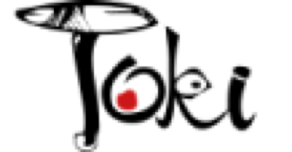 | Toki Rapa Nui | `toki` | PNG | color | website repo | cv.html collaborator carousel (solar volunteering). |
| 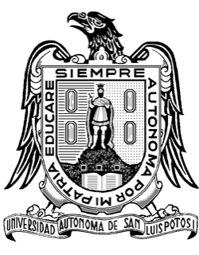 | Universidad Autónoma de San Luis Potosí | `uaslp` | PNG | color | website repo | Publications collaborator carousel. |
| 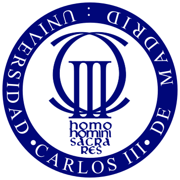 | Universidad Carlos III de Madrid | `uc3m` | SVG | color | website repo | Publications collaborator carousel. |
| 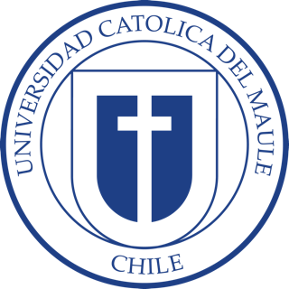 | Universidad Católica del Maule | `ucm` | PNG | color | website repo | Publications collaborator carousel. |
|  | Universidad de Chile | `uchile` | SVG, JPEG | horizontal, seal | [official](https://uchile.cl/presentacion/institucionalidad/simbolos/escudo) | cv.html timeline (degree, research assistant, teaching) and collaborator carousel; publications map. |
| 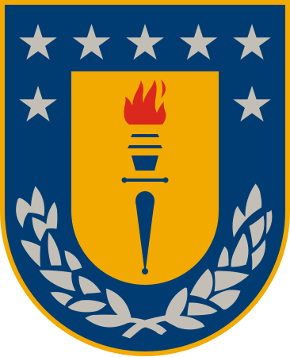 | Universidad de Concepción | `udec` | SVG | color | website repo | Publications collaborator carousel. |
| 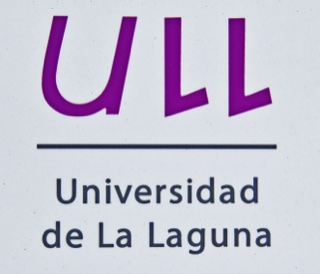 | Universidad de La Laguna | `ull` | JPEG | color | website repo | Publications collaborator carousel. |
| 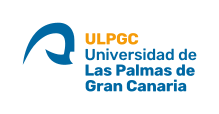 | Universidad de Las Palmas de Gran Canaria | `ulpgc` | SVG | acronym_black, acronym_color, acronym_white, compact_black, compact_color, compact_white, horizontal_color | [official](https://www.ulpgc.es/identidad-corporativa/marca-grafica-ulpgc) | Named throughout the site as the home university. cv.html currently shows the IDeTIC lockup (assets/logos/ulpgc-idetic.svg) in the ULPGC slots, not this university mark. |
| 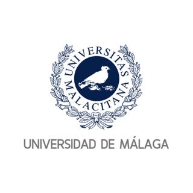 | Universidad de Málaga | `uma` | PNG | color | website repo | cv.html timeline (thesis tribunal president, 2026) and collaborator carousel. |
| 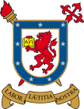 | Universidad de Santiago de Chile | `usach` | SVG | color | website repo | Publications collaborator carousel. |
|  | Universidad Diego Portales | `udp` | PNG | color | website repo | Publications collaborator carousel. |
| 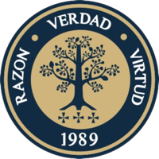 | Universidad San Sebastián | `uss` | PNG | color | website repo | Publications collaborator carousel. |
| 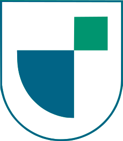 | Universidad Tecnológica Metropolitana | `utem` | SVG | color | website repo | Publications collaborator carousel. |
|  | University of Aveiro | `aveiro` | PNG | color | website repo | Publications collaborator carousel. |
|  | University of Cambridge | `cambridge` | PNG | color | website repo | Publications collaborator carousel. |
|  | University of Edinburgh | `edinburgh` | PNG | horizontal | [official](https://www.ed.ac.uk/) | Hotlinked on index.html and csndsp.html next to the CSNDSP 2026 mark. |
|  | University of Strathclyde | `strathclyde` | PNG | color | website repo | Publications collaborator carousel. |
|  | Veolia | `veolia` | SVG | color | website repo | cv.html collaborator carousel (Revo Project). |
|  | Visionar Automatización | `visionar` | PNG | black, white | [official](https://visionar.es/) | cv.html timeline (co-founder, 2025) and collaborator carousel. |
|  | Wooptix | `wooptix` | SVG | icon | website repo | Publications collaborator carousel. csndsp.html names Wooptix in a paper affiliation. |

White variants are drawn in white and will not show on this page’s background. `epn`, `newfocus`, and `pilighting` are white-only.

“Official” means this folder’s file was downloaded from that page. “Website repo” means the file was copied from this site. `logos.json` keeps the earlier note from `assets/logos/SOURCES.md`, including the organization page when that note names one.

## Gaps

### Missing

- Marie Skłodowska-Curie Actions programme emblem. The anniversary toolkit is hosted on CIRCABC and was not an open file. Use `european-union/` plus the funding sentence until that emblem is obtained.
- VISION ITN logo. The network is named in cv.html and has no image in the repo or on an open brand page found here.
- Generic COST Association logo. The NEWFOCUS action logo is included; the COST mark itself is not.
- OCC4SAT wordmark. index.html points at `assets/occ4sat-logo.png`, which is not in the repo. occ4sat.eu publishes only the geometric favicon kept as `occ4sat/occ4sat_icon.svg`.
- Quanzhou Institute of Equipment Manufacturing (Haixi Institute). publications data says no logo was found; the carousel shows the name.
- Universidad de Chile horizontal imagotype at print size. The logo server’s `horizontal.png` is 296×126. The website JPEG is 400×171. The manual’s download link (uchile.cl/u7910) no longer returns a package.
- ULPGC vertical and single-ink variants. The brand page lists them; this environment could not fetch that HTML. The CDN set (horizontal, acronym, compact, in colour, black, and white) is included.
- DIE vector, and any file larger than the 408×77 homepage header.
- FCFM white horizontal wordmark. The logo server has a white seal, not a white horizontal.
- Wooptix wordmark. Only the 60×58 icon from the company site is in the repo.
- Northumbria, Edinburgh, CSNDSP, and Visionar SVGs. Northumbria’s PNG is 2000 px wide. Edinburgh’s masthead PNG is 831×199. CSNDSP is 283×189. Visionar’s PNGs are large.

### Low resolution

A raster is listed when its longer side is under 600 px and the folder has no SVG or EPS. The website carousel intentionally stores files at about 320 px wide; those pixels are what was in the repo when no official vector was clearly available.

- **Alex Ekwueme Federal University, Ndufu-Alike** (`funai`): funai_color.png (320×88)
- **Chinese Academy of Sciences** (`cas`): cas_color.png (320×287)
- **CSNDSP** (`csndsp`): csndsp_color.png (283×189)
- **Departamento de Ingeniería Eléctrica, Universidad de Chile** (`die`): die_horizontal.png (408×77)
- **Escuela Politécnica Nacional** (`epn`): epn_white.png (320×160)
- **Instituto de Telecomunicações** (`it`): it_color.png (320×114)
- **Lightning Hybrids** (`lightning-hybrids`): lightning-hybrids_color.png (320×127)
- **NEWFOCUS COST Action CA19111** (`newfocus`): newfocus_white.png (320×75)
- **Pi Lighting** (`pilighting`): pilighting_white.png (320×75)
- **Politécnico de Leiria** (`leiria`): leiria_color.png (320×126)
- **Terralink** (`terralink`): terralink_color.png (320×90)
- **Toki Rapa Nui** (`toki`): toki_color.png (320×167)
- **Universidad Autónoma de San Luis Potosí** (`uaslp`): uaslp_color.png (250×320)
- **Universidad Católica del Maule** (`ucm`): ucm_color.png (320×320)
- **Universidad de Chile** (`uchile`): uchile_horizontal.jpg (400×171). A vector of a different variant is in the folder.
- **Universidad de La Laguna** (`ull`): ull_color.jpg (320×274)
- **Universidad de Málaga** (`uma`): uma_color.png (320×320)
- **Universidad Diego Portales** (`udp`): udp_color.png (320×78)
- **Universidad San Sebastián** (`uss`): uss_color.png (200×200)
- **University of Aveiro** (`aveiro`): aveiro_color.png (320×77)
- **University of Cambridge** (`cambridge`): cambridge_color.png (320×69)
- **University of Strathclyde** (`strathclyde`): strathclyde_color.png (320×100)

IEEE’s official web PNGs are 287×84. The EPS masters are in the same folder, so they are not listed here.

Universidad de Chile’s seal is an SVG. The horizontal wordmark in this library is the website JPEG at 400×171.

## Decisions still open

- This library sits in the website repository because the environment cannot create `inventor-loco/logos`. See the pull request for how to split it out. The website logo files should stay where the pages already point.
- ANID’s current Kit Digital is a joint Ministerio de Ciencia + ANID lockup for 2026, plus a stacked red-and-blue version on the same page. Which one a proposal should carry is a choice for the call’s rules.
- IEEE files were taken from the public Brand Experience toolkit. Using them means the [toolkit agreement](https://brand-experience.ieee.org/templates-tools-resources/toolkit-agreement/) applies.
- `assets/logos/ctu.svg` is not byte-identical to `logo_CVUT.svg` from the 2020 brand package. The library keeps the official package. Check that the carousel mark is the one you want on slides.
- The publications map calls the Leiria logo’s institution “Universidade de Leiria e Oeste”. The file itself is the Politécnico de Leiria mark recorded in `assets/logos/SOURCES.md`.
- Instituto de Telecomunicações is the 30-year campaign logo, downscaled. A standing wordmark was not fetched.
- ULPGC’s 35th-anniversary marks are on `cdn.ulpgc.es` and were left out.
- Many carousel logos were recorded in `assets/logos/SOURCES.md` as coming from Wikimedia rather than the university’s brand office. They were copied as-is and not redrawn. Replacing them needs the official file.

